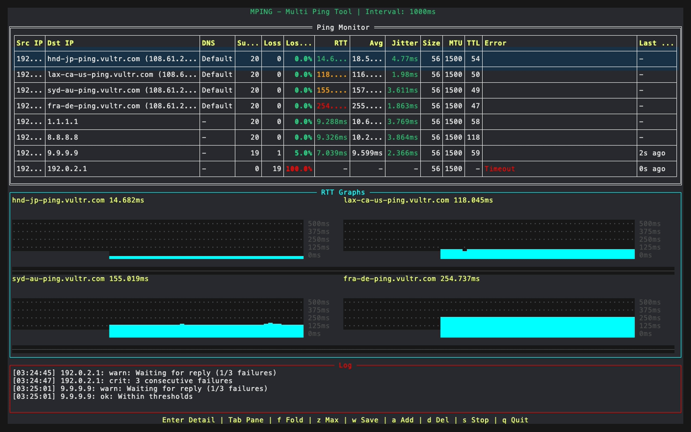
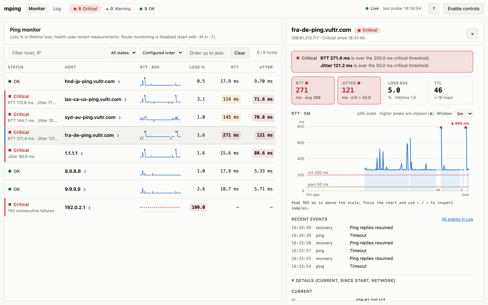

<p align="center">
  
</p>

# mping

**mping** は Go言語で書かれたターミナルベースのマルチターゲット Ping ツールです。複数のホストに対して同時に Ping を実行し、パケットロス率、RTT、ジッタ、TTL などの統計情報をリアルタイムで見やすい TUI (テキストユーザーインターフェース) で監視できます。`--web` でループバック限定の Web UI も使えます。

[](https://coveralls.io/github/nagayon-935/mping?branch=main)

[English](./README.md)



## 特徴

* **複数ターゲットへの Ping** — 複数のホストを並行して監視。実行中のホスト追加・削除も可能です。
* **リアルタイム統計** — パケットロス、RTT (Last / Avg / ジッタ)、TTL、エラーを、設定可能な閾値で色分け表示し、Log ペインにアラートを記録します。
* **幅に追従する TUI** — 端末の幅に合わせて列幅を配分し、足りない場合は優先度順に列ごと隠します。ホストごとの RTT スパークライン (**RTT 60s**) と、縦軸が自動スケールする **RTT Graphs** ペインを備え、どちらもロスを赤/オレンジで描き分けます。
* **YAML ホストリスト** — グループ、表示名、アドレス/範囲/CIDR のパターン、NetBox IP アドレス CSV の `include:`、ファイル変更時のホットリロードに対応します。
* **経路監視** — `-T` (traceroute) または `-M` (MTR 風の全ホップのロス/遅延監視)。どちらも経路フラップを検知します。
* **HTTP(S) ヘルスチェック** (`-H`) と **TCP/UDP ポート疎通チェック** (`-p`) のペイン。
* **PMTU 探索** (`-m`) — IPv4 / IPv6 に対応。
* **状態判定** — N 回連続失敗で到達不能、M 回連続応答で復旧とみなします (`--health-failures` / `--health-recoveries`)。
* **レポート** — 統計スナップショットを TUI (`w`) か Web UI の **Report** ボタンから JSON / CSV で保存できます。
* **Web UI** (`--web`) — フィルタ、ホスト別 Summary、アクティビティ、読み取り/操作用 JSON API を備えたブラウザダッシュボード。

## クイックスタート

```bash
# ソースからインストール (ビルド済みバイナリは下の「インストール」を参照)
make install

# 複数ホストを Ping (install.sh 実行後は sudo 不要)
mping google.com 1.1.1.1 8.8.8.8

# YAML からホストを読み込み、MTR 風の経路監視と Web UI を併用
mping -f hosts.yaml -M --web
```

**q** で終了、行を選んで **Enter** でホスト詳細を開きます。全オプションは [使い方とオプション](./guide/ja/usage.md)、キー操作は [TUI リファレンス](./guide/ja/tui.md) を参照してください。

## 対応プラットフォーム

| OS | アーキテクチャ | 備考 |
| :--- | :--- | :--- |
| Linux | amd64, arm64 | `setcap` による `CAP_NET_RAW` 付与を推奨 |
| macOS | amd64, arm64 (Apple Silicon) | `setuid` を使用 |
| Windows | amd64 | **実験的** — 下記参照 |

> **Windows について** — リリースには Windows 版も含まれますが、CI で確認しているのはビルドが通ることだけで、Windows 上での動作テストは行っていません。Raw ICMP ソケットを使うため、管理者として起動したシェルから実行してください。TTL と物理インターフェイスへのソケット固定は未対応ですが、`-I` は宛先ファミリーに応じたインターフェイスの送信元アドレスへ固定し、明示的な `-S` があればそちらを優先します。IPv4 の PMTU 探索は動作未確認、IPv6 の PMTU 探索は未対応です。

> **権限について** — mping は正確な TTL を取得するために Raw ICMP ソケットを使用します。Linux では `setcap cap_net_raw+ep` での権限付与を推奨します (`install.sh` が自動で処理します)。macOS では `setuid` を使用します。setuid 起動の計測プロセスはソケット操作に必要な権限を保持し、ユーザーファイル（`-f`・`include:`・保存するレポート）へのアクセス時に一時的に権限を下げます。そのため、これらのファイルは起動したユーザーの権限でアクセスします。Web UI のブラウザ向けの部分は、権限を恒久的に捨てた別プロセスで動きます（[Web UI](./guide/ja/web-ui.md) 参照）。

> **ターミナルの互換性** — Linux や macOS の標準ターミナルでは、色が正しく描画されないことがあります。色が正しく表示されない場合は、モダンなターミナルエミュレータ（iTerm2, Alacritty, kitty など）の使用を検討してください。

## インストール

[Releases](https://github.com/nagayon-935/mping/releases) からプラットフォームに合うアーカイブをダウンロードして展開し、`sudo ./install.sh` を実行します。ソースからビルドする場合:

```bash
git clone https://github.com/nagayon-935/mping.git
cd mping
make install      # ビルド + sudo ./install.sh
```

インストール後は `sudo` **なし**で実行できます。プラットフォーム別のコマンド、`INSTALL_DIR`、`go build` は [インストール](./guide/ja/installation.md) を参照してください。

## Web UI

`mping --web google.com 1.1.1.1` で `http://127.0.0.1:8080/` にダッシュボードを提供します (このマシンからのみ接続可):

<picture>
  <source media="(prefers-color-scheme: dark)" srcset="./assets/mping-web-dark.png">
  
</picture>

詳細・操作・JSON API は [Web UI](./guide/ja/web-ui.md) を参照してください。

## ドキュメント

| ガイド | 内容 |
| :--- | :--- |
| [インストール](./guide/ja/installation.md) | ビルド済みバイナリ、`install.sh`、ソースからのビルド |
| [使い方とオプション](./guide/ja/usage.md) | 実行例、全オプション、状態判定、`--check-config`、シェル補完 |
| [ホストファイル](./guide/ja/hosts-file.md) | YAML 形式、閾値、グループ、パターン、表示名、NetBox CSV の `include:` |
| [TUI リファレンス](./guide/ja/tui.md) | キー操作、レポート保存 (JSON/CSV)、表示カラム、狭い端末での表示 |
| [監視ペイン](./guide/ja/monitors.md) | Traceroute / MTR / HTTP / Port ペインと PMTU 探索 |
| [Web UI](./guide/ja/web-ui.md) | ブラウザダッシュボード、操作、JSON API |

実行できるサンプルは [examples/](./examples) にあります。スクリーンショットの再生成手順は [assets/demo](./assets/demo/README.md) にあります。

## ライセンス

MIT
