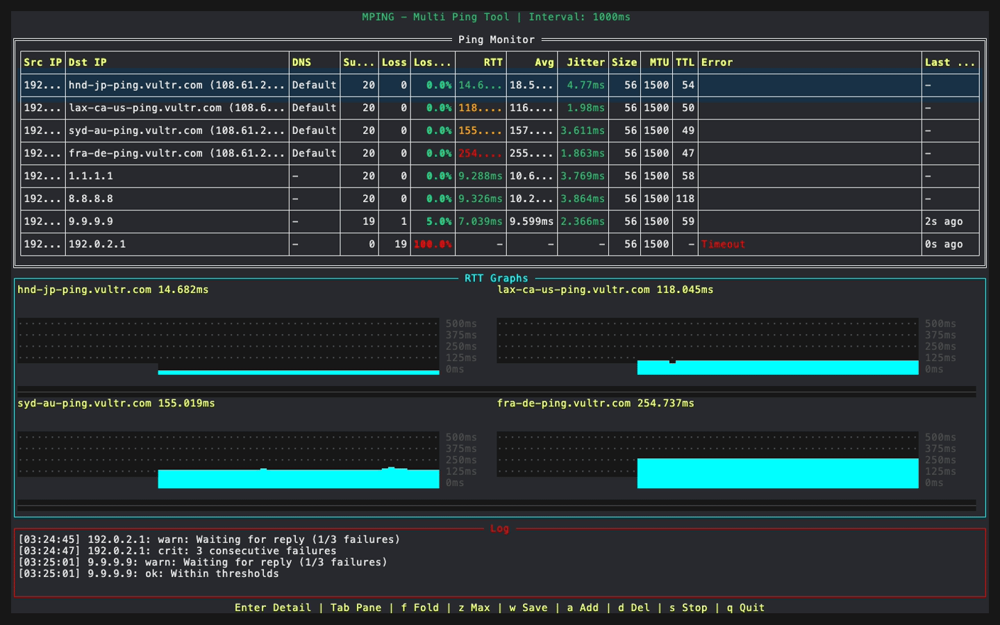
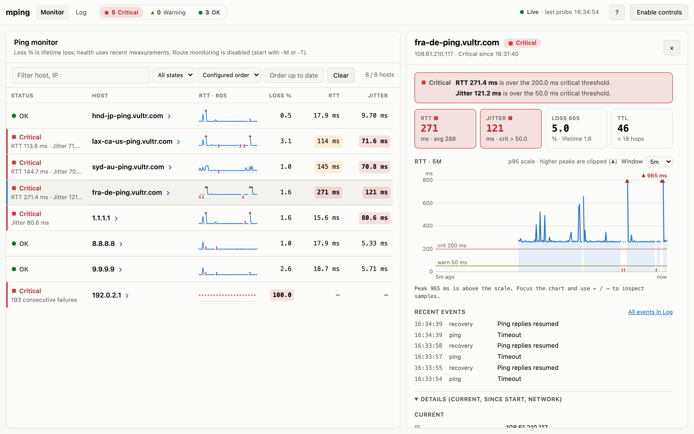

<p align="center">
  
</p>

# mping

**mping** is a terminal-based multi-target ping tool written in Go. It pings multiple hosts simultaneously and displays real-time statistics — packet loss, RTT, jitter, TTL, and more — in a clean TUI (Text User Interface). A loopback-only Web UI is available with `--web`.


[](https://coveralls.io/github/nagayon-935/mping?branch=main)
[](https://github.com/nagayon-935/mping/releases)

[日本語](./README.ja.md)



## Features

* **Multi-target ping** — monitor many hosts concurrently; targets can be added or removed while running.
* **Real-time statistics** — packet loss, RTT (last / avg / jitter), TTL and error messages, color-coded against configurable thresholds, with alerts in the Log pane.
* **Adaptive TUI** — columns are distributed over the terminal width and hidden whole, in priority order, on narrow screens. Per-host RTT sparkline (**RTT 60s**) and an **RTT Graphs** pane with auto-scaling Y-axis; lost probes are drawn in red/orange in both.
* **YAML host list** — groups, display names, address/range/CIDR patterns, `include:` of NetBox IP address CSV exports, and hot reload on file change.
* **Route monitoring** — `-T` (traceroute) or `-M` (MTR-style per-hop loss/latency), both with route-flap detection.
* **HTTP(S) health check** (`-H`) and **TCP/UDP port reachability check** (`-p`) panes.
* **PMTU discovery** (`-m`) for IPv4 and IPv6.
* **Health model** — confirm unavailability after N consecutive failures and recovery after M replies (`--health-failures` / `--health-recoveries`).
* **Reports** — save a statistics snapshot as JSON or CSV from the TUI (`w`) or the Web UI's **Report** button.
* **Web UI** (`--web`) — browser dashboard with filters, per-host Summary, activity feed and a read/control JSON API.

## Quick start

```bash
# Install from source (see "Installation" below for pre-built binaries)
make install

# Ping several hosts; no sudo needed after install.sh
mping google.com 1.1.1.1 8.8.8.8

# Hosts from a YAML file, with the MTR-style route monitor and the Web UI
mping -f hosts.yaml -M --web
```

Press **q** to quit and **Enter** on a row for host details. See [Usage and options](./guide/en/usage.md) for the full flag list and [TUI reference](./guide/en/tui.md) for key bindings.

## Supported platforms

| OS | Architecture | Notes |
| :--- | :--- | :--- |
| Linux | amd64, arm64 | Recommended: grant `CAP_NET_RAW` via `setcap` |
| macOS | amd64, arm64 (Apple Silicon) | Uses `setuid` |
| Windows | amd64 | **Experimental** — see below |

> **Windows** — Each release includes a Windows build, but CI only checks that it compiles; it is not tested on Windows. Run it from an Administrator shell (raw ICMP sockets need it). TTL is not reported. Physical interface binding is unsupported; `-I` binds the interface’s source address for each destination family, and explicit `-S` takes precedence. IPv4 PMTU discovery is unverified, and IPv6 PMTU discovery is unsupported.

> **Privileges required** — mping uses raw ICMP sockets to obtain accurate TTL values. On Linux the preferred approach is granting `CAP_NET_RAW` with `setcap`; `install.sh` handles this automatically. On macOS a `setuid` bit is set instead. With a `setuid` install, the measurement process retains elevated privileges for socket operations and temporarily drops them when accessing user files (`-f`, `include:`, saved reports), so those files are accessed with the invoking user's permissions. The Web UI's browser-facing part permanently drops privileges in a separate process (see [Web UI](./guide/en/web-ui.md)).

> **Terminal Compatibility** — Standard terminals on Linux and macOS may not render colors correctly. If you experience issues with color display, consider using a modern terminal emulator (e.g., iTerm2, Alacritty, or kitty).

## Installation

Download the archive for your platform from the [Releases](https://github.com/nagayon-935/mping/releases) page, extract it and run `sudo ./install.sh`; or build from source:

```bash
git clone https://github.com/nagayon-935/mping.git
cd mping
make install      # build + sudo ./install.sh
```

After installation, run mping **without** `sudo`. Per-platform commands, `INSTALL_DIR`, and `go build` are in [Installation](./guide/en/installation.md).

## Web UI

`mping --web google.com 1.1.1.1` serves a dashboard at `http://127.0.0.1:8080/` (this machine only):

<picture>
  <source media="(prefers-color-scheme: dark)" srcset="./assets/mping-web-dark.png">
  
</picture>

Details, controls and the JSON API: [Web UI](./guide/en/web-ui.md).

## Documentation

| Guide | Contents |
| :--- | :--- |
| [Installation](./guide/en/installation.md) | Pre-built binaries, `install.sh`, building from source |
| [Usage and options](./guide/en/usage.md) | Examples, all flags, health rules, `--check-config`, shell completion |
| [Hosts file](./guide/en/hosts-file.md) | YAML format, thresholds, groups, patterns, names, NetBox CSV `include:` |
| [TUI reference](./guide/en/tui.md) | Key bindings, saving reports (JSON/CSV), table columns, narrow terminals |
| [Monitors](./guide/en/monitors.md) | Traceroute, MTR, HTTP, Port panes and PMTU discovery |
| [Web UI](./guide/en/web-ui.md) | Browser dashboard, controls and the JSON API |

Runnable samples are in [examples/](./examples). The screenshots are regenerated as described in [assets/demo](./assets/demo/README.md).

## License

MIT
